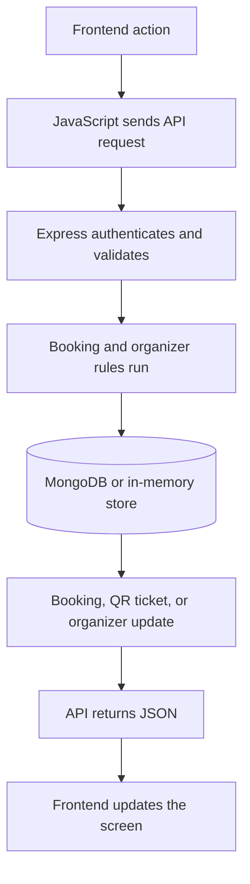

<div align="center">

# SeatLock AI

### Real seats. Real fans. A fairer way to book live events.

A full-stack ticket-booking demo with event discovery, temporary seat holds, simulated checkout, digital QR tickets, and an organizer workspace.

[Features](#-features) · [How it works](#-how-it-works) · [Quick start](#-quick-start) · [Demo boundaries](#-demo-boundaries)

</div>

---

## ✨ About

SeatLock AI is a live-event booking experience built around transparent rules and a simple promise: give genuine fans a fair shot at the seats they want. The interface takes inspiration from an editorial event poster—warm paper tones, vermilion accents, and bold typography—while the backend manages accounts, inventory, booking records, and ticket verification.

> **Demo project:** Event listings and payments are for demonstration. No real money is collected or transferred.

## 🎟️ Features

### For customers

- Discover fictional events across cities in India; search by event, city, or category.
- Create an account, sign in, and save favorite events.
- Choose up to four seats and hold them for a visible, demand-based countdown.
- Complete a simulated UPI, card, or wallet checkout with a transparent booking fee.
- View booking history, unique QR tickets, and ticket status.
- Cancel eligible future demo bookings; canceled seats return to inventory.
- Switch between light and dark themes.

### For organizers

- Create events with a guided, three-step form.
- Configure general-admission price, capacity, and an event-specific commission rate.
- Save drafts, publish events, and review inventory and booking-derived metrics.
- Verify ticket codes or scan QR codes where the browser supports camera scanning.
- Check in a valid ticket once; duplicate check-ins are rejected.

## 🔄 How it works



## 🧰 Built with

| Layer | Technology |
| --- | --- |
| Frontend | HTML, CSS, vanilla JavaScript |
| Server | Node.js, Express |
| Database | MongoDB and Mongoose (optional) |
| Authentication | Node.js `scrypt`, HTTP-only session cookies |
| QR tickets | `qrcode` npm package |

## 🚀 Quick start

### Requirements

- Node.js 18 or newer
- MongoDB is optional

### Run locally

```bash
npm install
npm start
```

Open **http://localhost:3000**.

### Optional: use MongoDB

Copy `.env.example` to `.env`, set `MONGODB_URI`, and restart the server. MongoDB replica-set configuration is required for transaction-backed seat holds.

```env
PORT=3000
MONGODB_URI=mongodb://127.0.0.1:27017/seatlock
HOLD_MIN_SECONDS=120
HOLD_MAX_SECONDS=300
MAX_SEATS_PER_HOLD=4
```

Without MongoDB, the app runs in memory demo mode. Data such as accounts, bookings, favorites, organizer-created events, and check-ins resets when the server stops.

## 🗂️ Project structure

```text
SeatLock/
├── public/                 # Customer and organizer pages, styles, and browser scripts
├── models.js               # MongoDB/Mongoose schemas
├── seed-data.js            # Fictional sample event listings
├── seed.js                 # Optional database seed command
├── server.js               # Express server and versioned REST API
├── package.json            # Scripts and dependencies
└── .env.example            # Local configuration template
```

## 🔌 API overview

All routes are under `/api/v1`.

| Area | Routes |
| --- | --- |
| Accounts | `POST /auth/register`, `POST /auth/login`, `POST /auth/logout`, `GET /auth/me` |
| Events | `GET /events`, `GET /events/:id` |
| Customer | `GET /me/favorites`, `POST /me/favorites/:eventId`, `GET /me/bookings` |
| Booking | `POST /holds`, `GET /holds/:id`, `DELETE /holds/:id`, `POST /checkout`, `POST /bookings/:id/cancel` |
| Organizer | `GET/POST /organizer/events`, `POST /organizer/events/:id/publish`, `GET /organizer/summary` |
| Ticket entry | `POST /organizer/verify-ticket`, `POST /organizer/check-in/:ticketId` |
| Health | `GET /admin/health` |

## ⚠️ Demo boundaries

- Checkout simulates authorization and never asks for card numbers, CVVs, UPI IDs, or wallet credentials.
- No real payment processing, tax calculation, refunds, or organizer settlements are connected.
- Seed events are fictional sample listings.
- Organizer-created events currently support one general-admission ticket type; published-event editing is not included.
- In-memory mode is for local demonstrations and resets on restart. Use a persistent database for shared testing.
- This project is not configured for real ticket sales or production deployment.

## 📄 License

No license has been added yet. Add a `LICENSE` file before redistributing this project publicly.
